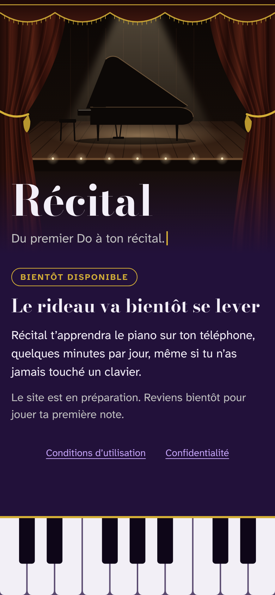
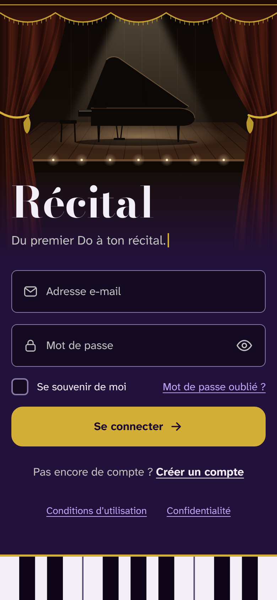
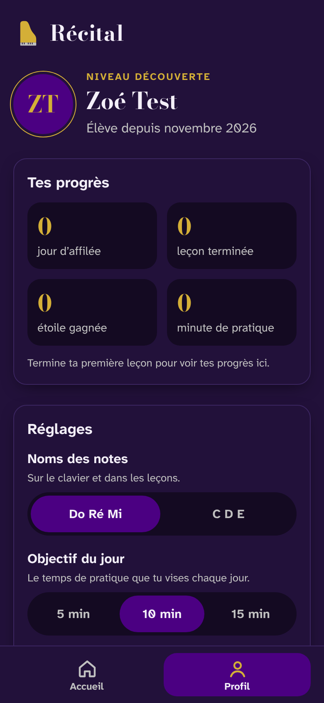
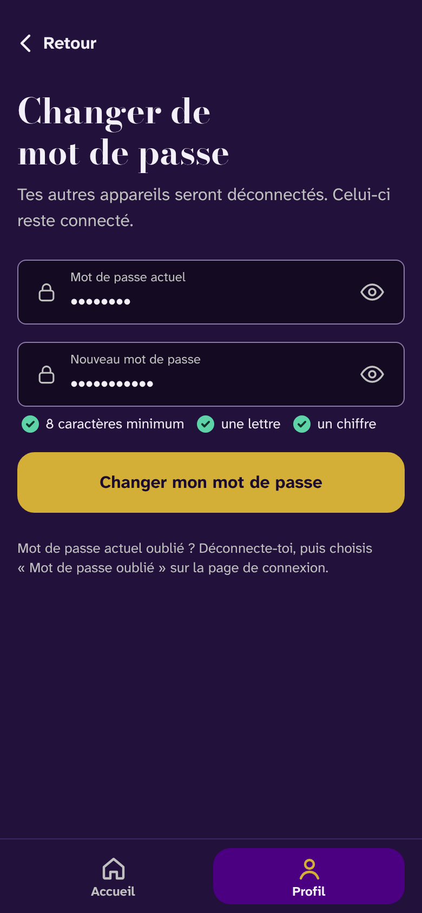

# Récital

**Learn the piano on your phone, from your very first C to your own recital.**

Récital is a mobile-first web app that teaches the piano to complete beginners, a few minutes a day, with an on-screen keyboard, a MIDI keyboard or a real piano. The interface is in French.

<p align="center">
  
  
  
  
</p>

> **Status: work in progress.** The account system is done. The music engine and the lessons come next, and the site is not online yet.

## Features

### Done

- **Accounts**: sign-up with email verification, login with a show-password button and "remember me", forgotten password by email.
- **Profile**: initials, level, progress overview, settings (note names *Do Ré Mi* or *C D E*, daily practice goal), editable first and last name.
- **Password change**: asks for the current password, logs out the other devices and sends a security email.
- **Coming-soon mode**: before launch, visitors only see a waiting page, while a secret link opens the whole site for testers.
- **Security**: bcrypt password hashing, leaked passwords refused (Have I Been Pwned, k-anonymity), invisible rate limiting against bots, strict Content Security Policy, CSRF protection and security headers.
- **Privacy (GDPR)**: minimal data, unconfirmed accounts deleted after 7 days, inactive accounts deleted after 2 years with a warning email, self-hosted fonts.
- **Accessibility**: real labels, an error summary linked to each field, keyboard-friendly settings, reduced-motion support.

### Next

- **Music engine**: on-screen keyboard with a piano sound, MIDI keyboards (on Android), falling notes and a metronome.
- **Lessons** for the first two levels (*Découverte* and *Débutant*), with progress tracking, daily streaks and badges.
- **Installable app** with an offline mode, and playing through the microphone.

## Tech stack

- **Back end**: Laravel 13 (PHP 8.3+), Blade views
- **Front end**: hand-written CSS and vanilla JavaScript, with no framework and no build step
- **Database**: SQLite in development, MySQL in production
- **Tests**: 61 feature tests with PHPUnit
- **Hosting (planned)**: alwaysdata, in France

Built with the help of an AI coding assistant (Claude).

## Run it locally

You need PHP 8.3+ and Composer, both included in [Laravel Herd](https://herd.laravel.com).

```bash
git clone https://github.com/n-mohammed06/Recital.git
cd Recital
composer install
cp .env.example .env
php artisan key:generate
php artisan migrate --seed
php artisan serve
```

Open http://localhost:8000 and log in with `test@example.com` and the password `password`. Emails, such as confirmation links, are written to `storage/logs/laravel.log`.

Run the tests with `php artisan test`.

## License

Personal project by [n-mohammed06](https://github.com/n-mohammed06). All rights reserved.
The fonts, Bodoni Moda and Atkinson Hyperlegible Next, are used under the SIL Open Font License.
